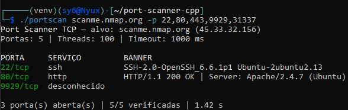

<div align="center">

# 🔍 Port Scanner TCP Multi-thread

**Scanner de portas TCP Connect em C++17 puro: sockets POSIX, `poll()`, threads e banner grabbing.**




</div>

---

## ⚠️ Aviso legal

Esta ferramenta é destinada **exclusivamente a fins educacionais e a testes em sistemas
que você possui ou para os quais tem autorização explícita e por escrito**.
Varrer redes ou máquinas de terceiros sem permissão pode violar leis (no Brasil, por exemplo,
a Lei 12.737/2012 e o Marco Civil da Internet) e os termos de uso de provedores.
O autor não se responsabiliza por uso indevido.

Alvos seguros para praticar: `127.0.0.1`, máquinas do seu laboratório e
[`scanme.nmap.org`](http://scanme.nmap.org) (mantido pelo projeto Nmap para testes — leia a política
de uso e não abuse).

## ✨ Funcionalidades

- 🌐 Aceita IPv4 ou domínio e resolve DNS via `getaddrinfo()`
- 🎯 Portas em formato flexível: `80`, `1-1024`, `22,80,8000-8100`
- ⏱️ **TCP Connect** com sockets não-bloqueantes + `poll()` e timeout configurável (não trava em portas filtradas)
- 🧵 Multi-thread com `std::thread`, contador atômico de trabalho e `std::mutex` nos resultados
- 🏷️ Identifica serviços comuns (FTP, SSH, HTTP, HTTPS, MySQL...) e captura **banners**
- 📊 Barra de progresso no terminal, lista só portas abertas e mostra o tempo total
- 🧼 **RAII** para sockets: nenhum descritor vaza, mesmo com 65.535 portas
- 🛑 `Ctrl-C` encerra com elegância e exibe resultados parciais

## 🛠️ Compilação

Requisitos: Linux, `g++` com suporte a C++17 e `make`.

```bash
git clone https://github.com/SEU-USUARIO/port-scanner-cpp.git
cd port-scanner-cpp
make
```

Equivale a `g++ -std=c++17 -O2 -pthread`. Para um build com ThreadSanitizer: `make debug`.

## 💻 Uso

```
./portscan <alvo> [opções]

  -p, --ports <spec>     Portas: 80 | 1-1024 | 22,80,8000-8100 (padrão: 1-1024)
  -t, --timeout <ms>     Timeout por porta em ms, 50-60000 (padrão: 1000)
  -T, --threads <n>      Threads simultâneas, 1-500 (padrão: 100)
      --no-banner        Não tenta capturar banners
      --no-progress      Não exibe a barra de progresso
  -h, --help             Mostra a ajuda
```

### Exemplos

```bash
# Máquina local, portas well-known
./portscan 127.0.0.1 -p 1-1024

# Domínio de testes do Nmap, mais rápido
./portscan scanme.nmap.org -p 20-100 -t 500 -T 200

# Portas específicas, sem banner
./portscan localhost -p 22,80,443,3306,8080 --no-banner
```

Exemplo de saída:

```
Port Scanner TCP — alvo: localhost (127.0.0.1)
Portas: 10000 | Threads: 100 | Timeout: 300 ms

PORTA     SERVIÇO         BANNER
2121/tcp  iprop           220 FTP Test Server ready
2222/tcp  desconhecido    SSH-2.0-OpenSSH_9.6 TestServer
3306/tcp  mysql
8080/tcp  http-proxy      HTTP/1.0 200 OK | Server: SimpleHTTP/0.6 Python/3.12.3

4 porta(s) aberta(s) | 10000/10000 verificadas | 0.34 s
```

### Códigos de saída

| Código | Significado |
| --- | --- |
| `0` | Varredura concluída |
| `1` | Falha de DNS ou erro em tempo de execução |
| `2` | Argumentos inválidos |
| `130` | Interrompida com Ctrl-C |

## 🧠 Como funciona

1. **Resolução:** `getaddrinfo()` restrito a `AF_INET`.
2. **Connect não-bloqueante:** cada porta recebe um socket `O_NONBLOCK`; `connect()` retorna `EINPROGRESS`
   e o `poll(POLLOUT)` espera até o timeout. Depois `SO_ERROR` diferencia **aberta** (0) de **fechada** (`ECONNREFUSED`);
   timeout indica porta **filtrada**.
3. **Threads:** um `std::atomic<size_t>` distribui os índices das portas, então não há trabalho duplicado
   nem fila com lock. O `std::mutex` protege apenas o vetor de resultados.
4. **Banner grabbing:** espera o servidor falar (FTP, SSH, SMTP). Em portas HTTP, se nada vier, envia `HEAD / HTTP/1.0`.
   O banner é sanitizado (primeira linha, só ASCII imprimível, no máximo 80 caracteres).
5. **RAII:** a classe `Socket` fecha o descritor no destrutor, mesmo em retornos antecipados.

## 🗂️ Estrutura

```
port-scanner-cpp/
├── include/   # headers (.hpp)
├── src/       # implementação (.cpp)
├── assets/    # demo-c.png
├── Makefile
└── README.md
```

## 🚧 Limitações

- Apenas IPv4 e TCP Connect (completa o handshake; **não** é um SYN scan furtivo e aparece nos logs do alvo).
- Exige Linux (usa `SOCK_NONBLOCK` e `MSG_NOSIGNAL`).
- Muitas threads exigem `ulimit -n` adequado.
- A detecção de serviço é por tabela de portas + banner, não por fingerprint.

## 🗺️ Próximos passos

- [ ] Suporte a IPv6 e CIDR
- [ ] Saída em JSON/CSV
- [ ] Testes unitários (Catch2/GoogleTest) para o parser de portas
- [ ] Rate limiting configurável
- [ ] CI com GitHub Actions

## 📄 Licença

MIT. Veja [LICENSE](LICENSE).

<div align="center">Feito com ☕ e C++ por <a href="https://github.com">wx</a>

